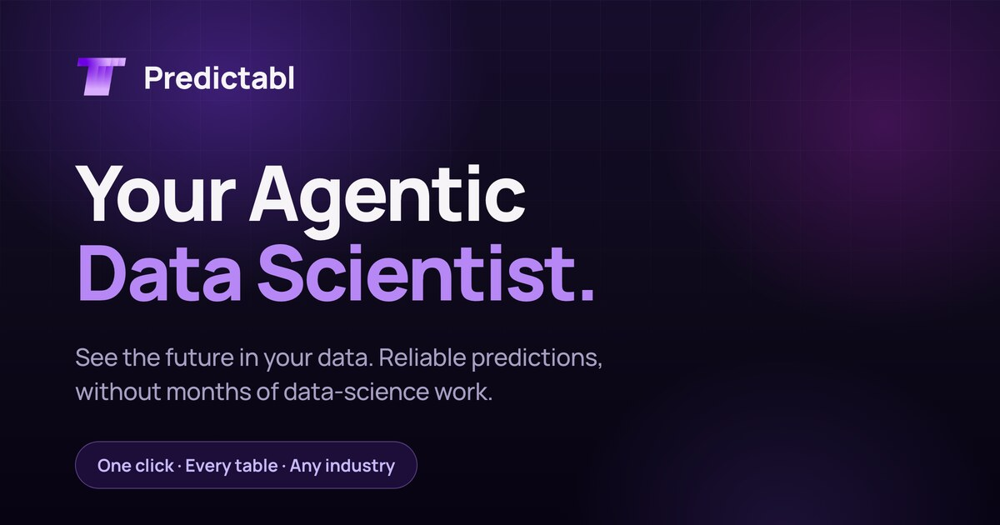

<p align="center">
  <a href="https://predictabl.tech/"></a>
</p>

<p align="center">
  <a href="https://predictabl.tech/"><b>Website</b></a> ·
  <a href="https://predictabl.tech/docs/"><b>Docs</b></a> ·
  <a href="https://predictabl.tech/blog/"><b>Blog</b></a> ·
  <a href="https://predictabl.tech/faq/"><b>FAQ</b></a> ·
  <a href="https://www.linkedin.com/company/predictabl/"><b>LinkedIn</b></a> ·
  <a href="https://pypi.org/project/predictabl/"><b>PyPI</b></a>
</p>

Predictabl turns structured business data into useful, deployable predictions,
without months of data-science work.

## Use it from code

```bash
pip install predictabl
export PREDICTABL_API_KEY=pk_...   # app.predictabl.tech → Settings → API & MCP
```

```python
import predictabl as pb

data = pb.connect("customers.csv")      # a file, a DataFrame, or a database
churn_model = data.predict("Which customers will churn?")

churn_model.predict(customer)
```

```text
Probability that customer churned: 0.82
```

**Repository:** [predictabl-python](https://github.com/predictabl/predictabl-python), the official Python library for the Predictabl API, with an MCP server for AI assistants.

## Read more

- [Benchmarking Predictabl on RelArena](https://predictabl.tech/blog/relarena-benchmark/)
- [Predicting the Next Best Move](https://predictabl.tech/blog/predicting-the-next-best-move/)
- [Agentic Data Science, Live at Google Berlin](https://predictabl.tech/blog/agentic-data-science-talk-berlin/)
